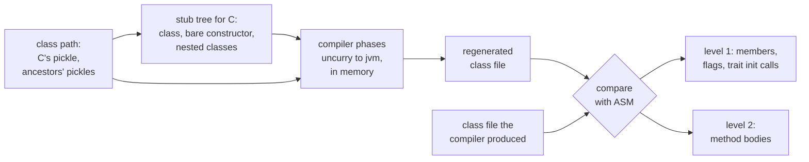
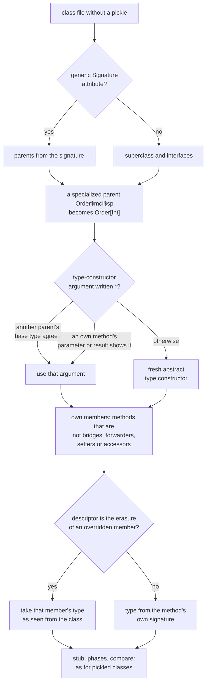
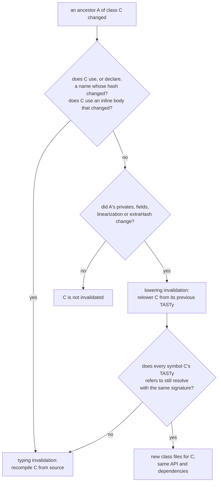
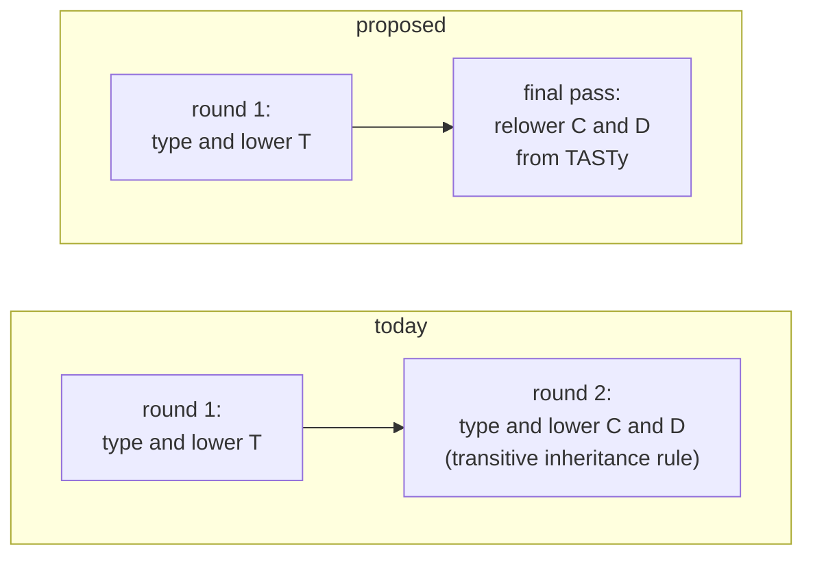

# Link step spike: ancestor-derived members from pickles

The question is whether the parts of a Scala 2 class file that depend on the class's ancestors can be regenerated from pickles alone, without the class's own typed trees. For classes that have a pickle, they can, with two exceptions that both come from specialization and one naming detail. Local and anonymous classes have no pickle. A best-effort mode that rebuilds their symbols from Java generic signatures handles most of the ones it can stub, but cannot stub a class whose parent is an inner class.

## Motivation

In development, iteration speed depends on how much Zinc recompiles after an edit, and much of Zinc's invalidation exists to protect lowering, not typing:

- A class's inheritance dependents are invalidated transitively, whatever changed.
- A trait's `extraHash` folds in its parents', so even a private member of a trait invalidates every class that mixes it in (sbt/zinc#662, sbt/zinc#1289, sbt/zinc#1794).
- Same-source inheritance had an under-compilation (sbt/zinc#417, sbt/zinc#424).

These rules exist because a subclass's class file bakes in facts about its ancestors: mixin forwarders, trait fields and setters, bridges, `$init$` calls. Typing the subclass needs none of them. If those parts can be regenerated from the subclass's pickle and its ancestors' pickles, a private or layout change in an ancestor needs only a relink of its subclasses, not a retypecheck. Zinc could then drop the `extraHash` path and stop invalidating inheritance dependents for such changes, and the loop after editing a widely mixed-in trait would cost a typecheck of the edited file plus a relink of its subclasses. A later step could do the relink when a class loads, with a `java.lang.instrument` agent, so the build would not rewrite the subclasses' class files at all.

This spike tests the premise: which ancestor-derived parts can be regenerated from pickles alone, and which lowering steps still need the class's own trees.

## Method

For every top-level class and object with a pickle, the tool unpickles the symbol from the class path and builds a stub tree: the class, a primary constructor whose only statement is `super.<init>(zeros)`, and the same stub for each member class and object. None of the class's own methods, fields or initializers are in the tree. The stub runs through the compiler's own phases from uncurry to jvm, into memory. Everything the backend emits beyond the stub is derived from symbols, that is from the class's pickle and its ancestors' pickles.

The tool then compares each regenerated class file with the one the compiler produced, using ASM:

- Level 1: name, descriptor and access flags of every regenerated member; the sequence of `$init$` calls in the constructor (for an object, in its static initializer); and, in the other direction, every member of the real class that looks ancestor-derived but was not regenerated. That covers bridges, trait setters, trait super accessors, outer accessors of traits, accessors of inherited objects, lazy-val bitmaps, mixin-forwarder bodies and specialized variants.
- Level 2: the instructions of every regenerated method, with labels, line numbers and frames dropped.

The class's own fields, and its own outer accessor, are left out on both sides: the backend emits them from the class's decls even without a tree. Static forwarders are in, since they are generated from the object's whole member list, inherited members included.

Corpora: reflect, compiler, interactive, scaladoc and scalap from `build/quick` of this branch, and cats (commit 813f1bc8e3) kernel, core and free, compiled with the quick compiler and cats's own options (`-Xsource:3 -release 8`, kind-projector, better-monadic-for). Regenerating a corpus takes 0.5 to 3.5 seconds.

## Results

"Derived" is the number of regenerated classes with at least one ancestor-derived member or `$init$` call. "Fresh" is level 1 exact when the compilation unit's fresh-name counter is ignored (see below). "Local/anon" are class files with no pickle of their own, and "with signs" those of them that have a member the reverse check above would call ancestor-derived, or a `$init$` call.

| corpus | class files | regenerated | derived | level 1 exact | level 2 exact | fresh | local/anon | with signs |
|---|---:|---:|---:|---:|---:|---:|---:|---:|
| reflect | 1599 | 1432 | 656 | 655 | 655 | 655 | 167 | 123 |
| compiler | 2511 | 2124 | 1123 | 1120 | 1120 | 1122 | 387 | 274 |
| interactive | 169 | 143 | 78 | 67 | 67 | 67 | 26 | 15 |
| scaladoc | 403 | 318 | 208 | 208 | 208 | 208 | 85 | 76 |
| scalap | 201 | 192 | 160 | 160 | 160 | 160 | 9 | 8 |
| cats-kernel | 1138 | 570 | 219 | 191 | 191 | 191 | 568 | 568 |
| cats-core | 2425 | 1697 | 549 | 549 | 549 | 549 | 728 | 647 |
| cats-free | 125 | 81 | 11 | 11 | 11 | 11 | 44 | 37 |
| total | 8571 | 6557 | 3004 | 2961 | 2961 | 2963 | 2014 | 1748 |

The local/anon column also holds 32 other class files: Java-defined classes, classes nested inside a local class, and `CallGraph` with its 16 nested classes (see below).

Members regenerated, over all corpora:

| kind | members |
|---|---:|
| mixin forwarder | 10929 |
| static forwarder (companion or mirror class) | 8072 |
| specialized forwarder (to an ancestor's `m$mcI$sp`) | 8034 |
| bridge | 3454 |
| inherited object accessor | 1797 |
| trait setter (`T$_setter_$x_$eq`) | 1644 |
| trait field | 1291 |
| trait field accessor | 1035 |
| inherited object field (`O$module`) | 688 |
| trait lazy val (accessor and `$lzycompute`) | 512 |
| trait outer accessor (`T$$$outer`) | 249 |
| lazy val bitmap | 188 |
| trait super accessor | 107 |
| trait field setter | 92 |

Wherever level 1 matched, level 2 matched too: no regenerated method with the right name, descriptor and flags had a different body.

Some of the steps that looked likely to need C's own trees do not:

- `$init$` calls. 1307 regenerated classes call `$init$`, and every sequence matches the real constructor or, for objects, static initializer. Erasure adds them from `clazz.mixinClasses`.
- Trait lazy vals. The class's `x$lzycompute` calls `T.x$(this)`, so the initializer stays in the trait. The bitmap field is shared with the class's own lazy vals, and its width and bit positions still come out right, because the allocation counts the pickled lazy decls, not trees. A sample class with two trait lazy vals and eight of its own matches exactly.
- Trait super accessors, outer accessors of inner traits, and accessors of objects inherited from traits all match.

Running one class per `Global` gives the same numbers as 400 classes per `Global` for reflect and cats-kernel. So the results do not depend on whether an ancestor in the same module is compiled in the same run or read from the class path.

## Mismatches

### Specialized variants of the class's own methods (175 classes)

This kind needs C's trees. There are three cases.

- A class overrides a method that an ancestor specializes (26 classes: 13 in cats-kernel, `EmptyAction`, `Flags.MapFlags` and 11 `CompilerControl` work items in interactive). Example: `scala.tools.nsc.util.EmptyAction extends (() => Unit)`. The real class has `apply$mcV$sp()V`, which holds the body of the class's own `apply`, and `apply()V` becomes `invokevirtual apply$mcV$sp`. The specialize phase moves the class's own body into the specialized method. If the ancestor's specialization changes, both the class's own `apply` and the new method change.
- A trait overrides a method that its parent specializes (36 traits in cats-kernel). Example: `cats.kernel.Band` overrides `repeatedCombineN`, which `Semigroup` specializes. The real trait has `repeatedCombineN$mcI$sp(II)I` and its siblings, each boxing its arguments and calling the generic `repeatedCombineN`. The body depends only on symbols, but the specialize phase creates these methods from the class's own `DefDef`, so the stub does not get them.
- Specialized subclasses and subtraits (113 in cats-kernel, such as `cats.kernel.Eq$mcJ$sp`). The stub produces these classes and their ancestor-derived members match, but their specialized methods are copies of the generic class's trees. `Eq$mcJ$sp` lacks `neqv$mcJ$sp(JJ)Z`, among others.

The same cause makes the one failure in the scala corpora. `scala.tools.nsc.backend.jvm.opt.CallGraph` crashes in constructors with "no constructor in template" for `CallGraph$FLazy$mcI$sp`, because the specialized subclass's template is built from `FLazy`'s trees. The whole top-level unit is lost, so `CallGraph` and its 16 nested classes are not regenerated.

### Fresh-name counter in inherited object accessors (2 classes)

Example: `scala.tools.nsc.classpath.ZipAndJarSourcePathFactory$` regenerates `ZipSettings$lzycompute$1()V`. The real class has `ZipSettings$lzycompute$2()V`, and the accessor `ZipSettings()` calls it. The accessor for an object inherited from a trait contains a local `def O$lzycompute`. Lambdalift lifts it and appends the compilation unit's fresh-name counter, so the number depends on how many local functions come before it in the source file. The member is private, so a link step can rename it to whatever the class already uses, or the compiler could name it deterministically. Ignoring the counter makes both classes exact. The sample corpus (`test/sample.scala`) shows the same mismatch in 7 of 7 such accessors.

### Specialization of class-path ancestors depends on what the run asked for

This one is fixed in the tool, but a link step has to handle it too. `SpecializeTypes.transformInfo` skips classes that are not compiled in the run if their info is first asked for after the specialize phase. In a normal compile, the class's own code asks for most of its ancestors. The stub does not, so without help, specialized members of class-path ancestors and the bridges erasure derives from them go missing. The tool asks for the info of every base class during the specialize phase. Without that, cats-core loses 16 exact classes and cats-kernel 1. Example: `cats.ContravariantMonoidalMonoid` loses the bridge `reverse$mcJ$sp()Lcats/kernel/Semigroup;`, which calls `reverse$mcJ$sp()Lcats/kernel/Monoid;`, and `cats.data.NonEmptyListOrder` loses 135 forwarders such as `compare$mcZ$sp`. The scala corpora are unaffected. The real compile has the same exposure: whether an ancestor's specialized members exist in C depends on what C's code, or anything else in the run, referenced.

### Local and anonymous classes (2014 class files, 1748 with ancestor-derived members)

A local or anonymous class is not in any pickle, so the pickle-based method cannot regenerate it. In cats almost every anonymous instance (`new Semigroup[A] { ... }`) gets mixin forwarders, specialized forwarders and bridges from its parents. The next section is a best-effort mode for these classes.

## Local and anonymous classes from Java signatures (best effort)

This mode builds a class symbol from the class file alone, stubs it the same way, and runs the same phases and comparison. The rules are in `LocalStubs.scala`:

- Parents come from the generic `Signature` attribute, or from the superclass and interfaces when there is none. A specialized parent such as `Order$mcI$sp` becomes `Order[Int]`, with the letters put back in the place of the specialized type parameters.
- Type variables of the enclosing method become abstract type members. `Object` becomes `Any` and `BoxedUnit` becomes `Unit`.
- Java signatures have no kinds, and a type lambda argument is written `*` (`CommutativeMonad<*>`). Such an argument is taken from another parent's base type where one agrees, then from the class's own methods (`filterA(Const<TC;TA;>, ..)` against the parent's `filterA(fa: F[A], ..)` gives `F = Const[C, *]`), and otherwise is a fresh abstract type constructor.
- The class's own members are guessed from the class file. An own method takes the type of the member it overrides when its descriptor is the erasure of that member as seen from the class, and its signature's type otherwise.
- The stub is a top-level class, because the phases need a class's tree inside its owner's tree, and the enclosing class has no tree here. So it has no outer pointer.

| corpus | class files | regenerated | derived | level 1 exact | level 2 exact | failed |
|---|---:|---:|---:|---:|---:|---:|
| reflect | 162 | 82 | 54 | 53 | 53 | 80 |
| compiler | 363 | 244 | 159 | 156 | 156 | 119 |
| interactive | 26 | 20 | 10 | 8 | 8 | 6 |
| scaladoc | 85 | 57 | 48 | 39 | 39 | 28 |
| scalap | 9 | 8 | 7 | 5 | 5 | 1 |
| cats-kernel | 568 | 568 | 568 | 138 | 138 | 0 |
| cats-core | 728 | 701 | 621 | 598 | 598 | 27 |
| cats-free | 44 | 39 | 32 | 31 | 31 | 5 |
| total | 1985 | 1719 | 1499 | 1028 | 1028 | 266 |

The class files are the local/anon column above, less Java classes and the classes of `CallGraph`. Among the regenerated members are 40777 specialized forwarders, 12564 mixin forwarders and 7799 bridges, and 1231 classes have `$init$` calls.

What is lost:

- **A parent that is an inner class (222 classes, all failures in explicitouter).** Example: `scala.reflect.internal.Positions$worker$1$solidChildrenCollector$`, whose parent is a member class of the `SymbolTable` cake. The stub has no outer instance to pass to the parent's constructor. This accounts for nearly all failures in the scala corpora. Placing the stub inside its enclosing class made things worse, since the enclosing class has no tree in the run.
- **Specialized variants of the class's own methods (429 classes, all in cats-kernel).** These are the same as in the pickle-based run. `new Order[Byte] { def compare(x: Byte, y: Byte) = .. }` has `compare$mcB$sp(BB)I`, which holds the class's own body. Apart from these methods, all 568 cats-kernel classes match.
- **Type arguments the signature does not carry (39 failures in erasure, 33 classes missing bridges).** Example of a failure: `cats.data.OneAndInstances$$anon$6`, where two parents disagree on a lost type lambda and erasure reports a name clash. Example of a missing bridge: `cats.data.BinestedInstances$$anon$1`, where the real class has a bridge `dimap(Object, Function1, Function1)Object`. The class's own `dimap` does not override the parent's in the stub, because the parent's type argument could not be recovered. Value classes are another case: a signature writes `NonEmptyVector` as its underlying `Vector`. The overriding rule above recovers that when the descriptors match.
- **The class's own lazy vals (21 classes miss a `bitmap$0`).** The own-member guess does not model lazy vals, so the bitmap they share is missing.

These numbers could flatter the method. The guess about which members are the class's own uses the same signs as the comparison's reverse check, so a forwarder wrongly taken as own would be neither regenerated nor flagged. As a check, the same mode was run over the classes that do have a pickle (`--local-all true`), leaving out objects because the stub is a plain class, and the result was compared with the pickle-based run. That check first showed members the reverse check did not flag:
- bridges sharing a name with an own method;
- outer accessors of traits;
- accessors of inherited objects;
- bitmaps.

The check was tightened, and all numbers here were taken after that. Now, over the 1045 classes exact in both runs, the class-file mode misses:
- static forwarders, because objects were left out;
- 30 trait fields: a field looks the same whether it is the class's own or a trait's, so the reverse check cannot flag it;
- one accessor of an inherited object.

Over all classes, pickled ones included, the class-file mode is level 1 exact for 1636 of the 2191 classes it regenerates with ancestor-derived members, against 2961 of 3004 from pickles. Most of the difference comes from three things:
- the classes' own specialized methods (590 classes);
- trait setters and super accessors of pickled traits taken as derived, since the own-member guess is written for classes (203 traits);
- own lazy vals (101 classes).

So Java signatures get close for local classes whose parents are top-level, and fail for those inside a cake. A pickle of each local class's parents and members would make this mode exact without the guesses.

## Not measured

The comparison covers the members the stub produces. It does not look at the class's own method bodies, so it says nothing about ancestor facts that reach C's own call sites, for example:

- expanded names of trait members that C's code calls (`p$T$$x`)
- `invokestatic T.m$` for `super[T].m`
- calls that specialization redirects to `m$mcI$sp`

Reasoning suggests those need C's trees whenever the ancestor's change renames something C calls; this spike did not check it. Changes to how a referenced type erases, and inlining with `-opt`, are out of scope as planned. Neither the quick build nor the cats build uses `-opt`.

## Sketch: relowering from TASTy in Zinc and Scala 3

This section is a design sketch, not something the spike built or measured.

Scala 3 is a better fit for the idea than Scala 2. Its TASTy holds the class's full typed trees, method bodies included, not just its signatures. Scala 3 can also already resume a compilation from TASTy (`-from-tasty`), running the phases after pickling on trees read back from `.tasty` files. So the cases above that need the class's own trees (specialized variants of own methods, ancestor renames that reach the class's call sites, local and anonymous classes) are all covered: relowering from TASTy re-derives the whole class file from the class's own trees, against the current ancestors, without parsing or typing. The pickle-only approach would only be needed if TASTy had to be avoided, for example to splice members into a class file at load time.

**What Zinc would need to know.** Zinc already tells inheritance dependencies from member-reference dependencies, but either one leads to a recompile from source. It would need to separate two reasons:

- *Typing invalidation.* The class's typed trees may change: its own source changed, a name it uses changed (the existing name-hash rule), or it declares a member whose name the ancestor's change added, removed or retyped (overriding checks run in the typer). Inline method bodies count here, since Scala 3 expands them during typing and the expansion is part of the class's TASTy.
- *Lowering invalidation.* The class's typed trees are the same, but its class file may not be: an ancestor's private members, field layout, linearization or `extraHash` changed, and nothing the class uses or overrides. This covers most of what the inheritance rule and `extraHash` are for.

A class with only lowering invalidations is relowered from its previous TASTy. Any typing invalidation means a normal recompile from source.

**Changes in Zinc.**

- Classify each invalidation as typing or lowering. Inheritance dependents go through the name-hash filter for typing, as member-reference dependents already do. Whatever the filter lets pass, and every case the `extraHash` path would have caught, becomes lowering invalidation.
- Keep the previous `.tasty` of a class scheduled for relowering. The class-file manager currently deletes all outputs of invalidated sources before it compiles. It would delete only the class files, and roll them back as now if the compile fails.
- Hand the compiler two lists: sources to compile, and TASTy files to relower. Relowered classes skip API extraction and dependency extraction. Their API and dependencies are those of the previous TASTy, so Zinc copies them from the previous analysis.

**Changes in Scala 3.** Accept both inputs in one run, so that relowered classes are lowered against the freshly typed ancestors in the same run. This is close to what `-from-tasty` does, applied to a subset of the run's classes. It also needs one check: the previous TASTy is only reusable if every symbol it refers to still resolves to a member with the same signature. If the check fails, the class falls back to a typing invalidation. That keeps a misclassification from producing a broken class file.

**The terminal round.** Relowering cannot change a class's API, because the class's TASTy is reused unchanged. So relowering never adds invalidations, and Zinc's cycle cannot continue because of it. Two optimizations follow.

- If every task in a round is a relowering, the round is the last one: Zinc can skip the API comparison for it and stop after it.
- In a mixed round, the relowering can be deferred. Its output feeds nothing in the next round, and a later round may yet promote the same class to a typing invalidation, which would make the relowering wasted. So Zinc can collect relowering tasks across rounds, drop those whose class was later recompiled from source, and run the rest once, after typing has converged. That final pass also lowers every class against its ancestors' final state, so it never has to run twice for one class.

Today, with a private change to a trait `T` that `C` extends, and `D` extends `C`:

Today every subclass is typed again. In the proposed case the final pass is terminal by construction, since relowering cannot change an API.

**Expected gain.** A trait used widely across a build is the case that hurts most today: a private change to it recompiles every subclass from source, and can cascade over several rounds through the transitive inheritance rule. With this scheme, such an edit costs one typecheck of the edited file plus one relowering pass over its subclasses, in a single round. Typing is usually the largest share of compile time, so most of the saving would come from skipping it; this spike did not measure how large that share is in these builds.

**Scala 2.** Scala 2's pickles carry no trees, so the same scheme needs either trees kept alongside the pickles or the symbol-only relink measured here. The symbol-only relink needs the class's existing class file for its own members, and has the gaps listed under Mismatches. The terminal-round reasoning applies unchanged.

## Running it

`tools/link-step/run --corpus DIR --cp DEPS [--label NAME] [--out DIR] [--batch N] [--force-specialized-ancestors false] [--local false] [--local-all true] [-- scalac options]` compiles the tool against `build/quick` and checks one corpus: first the pickled classes, then the class files without a pickle. It writes `<label>-summary.txt`, `<label>.tsv` (one line per mismatch), `<label>-classes.tsv` and `<label>-members.tsv`, and the same with `-local` (or `-local-all`) for the second pass. `tools/link-step/corpora.sh OUT_DIR [CATS_BUILD_DIR]` reproduces the tables above. `Relinker` is the regeneration step, kept apart from the comparison so that a later agent can reuse it.
