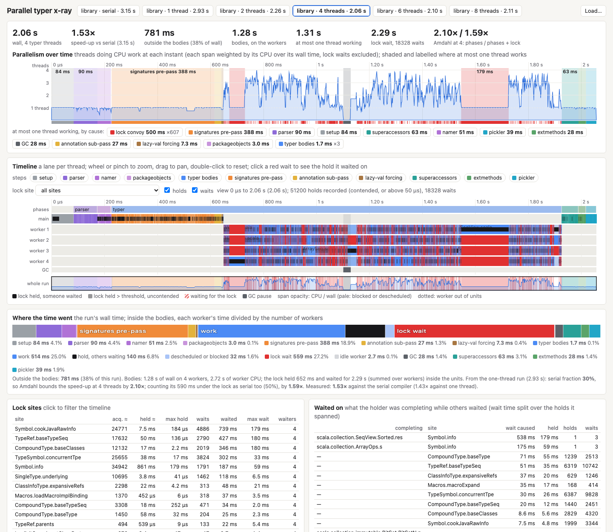
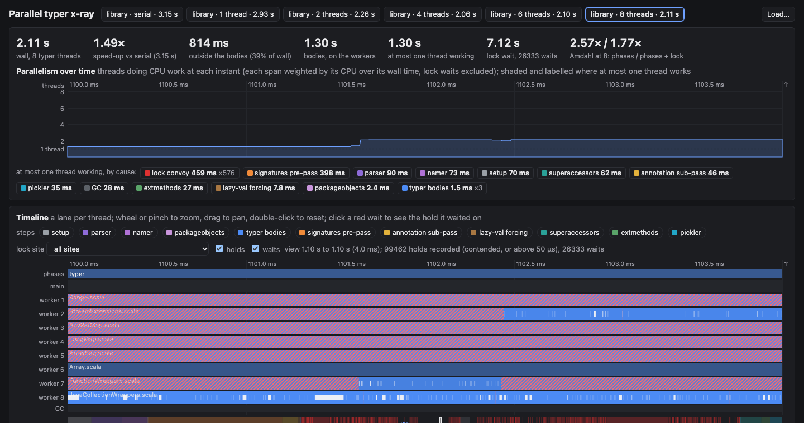

# Parallel typer x-ray

A page that shows what each thread of a `scalac -Yparallel-typer -Ystop-after:pickler` run did and when, so that the serial parts and the waits stand out: the stretches where at most one thread works, why (a serial step, a convoy on the completion lock, the tail of the bodies, GC), which holds of the lock others waited on, and how the run scales with the number of threads. It ports the batch and thread-scaling views of the Scala 3 x-ray (`presentation-compiler/test/dotty/tools/pc/xray` in retronym/scala3, `ParallelBatch.Timeline`) and adds the lock's holds and waits, which Scala 3 does not record.





## Running it

```bash
sbt dist/mkQuick                                   # once
tools/parallel-typer/xray/run.sh library           # or reflect, compiler, a file of scalac arguments
open tools/parallel-typer/xray/index.html
```

`run.sh <corpus> ["1 2 4 8"]` builds the corpus's arguments as `oracle.sh` does, compiles `XrayBench.scala` against a snapshot of `build/quick`, and runs one JVM (`-Xss64m -Xms6g -Xmx6g`, plus `JAVA_OPTS`) that compiles the corpus `WARMUP` times (default 14, cycling through the configurations, unrecorded), then once per configuration with the recording on: `serial` (no `-Yparallel-typer`, the baseline of the speed-ups) and each thread count; the default list is 1 2 4 8 and, on Apple silicon, the number of the fastest cores (`hw.perflevel0.physicalcpu`). It writes one JSON per run under `$OUT` (default `/tmp/parallel-typer-xray/<corpus>`), all of them as `timeline.data.js` beside the page, and prints a text summary (`summary.js`, which runs the page's own analysis under node). `OVERHEAD=<pairs> run.sh library 4` instead alternates compilations with the recording off and on and prints the medians.

`profile.sh <corpus> [threads]` (default 4) adds profiles, for the *Where the CPU went* section. In one warm JVM under jvm-perf-lab's patched async-profiler (`PERFLAB`, default `~/code/retronym/jvm-perf-lab`) it records `serial` without a profile, as the baseline of the speed-ups, then the thread count with a CPU profile and again with a wall clock profile, each over `REPEATS` compilations (default 10). `CPU_INTERVAL` is 500us and `WALL_INTERVAL` 1ms. Raw output and the data go to `profiles/<corpus>/`, and `timeline.data.js` is regenerated from every corpus there, so run it once per corpus and serve the page:

```bash
tools/parallel-typer/xray/profile.sh library
tools/parallel-typer/xray/profile.sh compiler
cd tools/parallel-typer/xray && python3 -m http.server   # then open index.html
```

`run.sh` overwrites `timeline.data.js` with its own recording; `cat profiles/*/timeline.data.js > timeline.data.js` brings the profiles back. `OVERHEAD=<rounds> profile.sh library 4` alternates nothing on, the timeline, and the timeline with each profile, and prints the medians.

A single run from the command line: `-Dscalac.parallelTyper.xray=<file.json>` writes the recording of each `Run` to that file. The page loads `timeline.data.js` from beside it (it works from `file://`), and *Load…* or a drop on the page adds run JSON files or another `timeline.data.js`; a run replaces a loaded run of the same corpus and configuration.

## Reading the page

The buttons at the top pick the run; the numbers under them are its wall time, its speed-up against the serial compiler, the time outside the bodies (everything that runs on the main thread only), the bodies' wall time, the time during which at most one thread did CPU work, the summed lock wait, and the speed-up Amdahl allows at this thread count (see below).

**Parallelism over time** is the first thing to look at. The blue area is the number of threads doing CPU work at each instant: each span counts with the ratio of its thread's CPU time to its wall time (so a descheduled or monitor-blocked thread counts less), and a thread waiting for the completion lock counts as zero. Where at most one thread works, the background is shaded by the cause and labelled with its duration: a serial step (setup, parser, namer, packageobjects, the signatures pre-pass, the annotation sub-pass, lazy-val forcing, superaccessors, extmethods, pickler), a *lock convoy* (during the bodies, one thread working and the others waiting for the lock), the *tail* (the other workers are out of units), or GC. Stretches too narrow to shade show in the ribbon under the chart. The chips under it total each cause over the run; a click zooms to its longest stretch. The chart shares its zoom with the timeline.

**Timeline**: a lane per thread (main, then the workers, then GC pauses), the phases above them. A span is a unit in a step, coloured by step; its opacity is its CPU time over its wall time. Over the spans, the lock: a dark band is a hold (solid when someone waited on it, faint when it only took longer than the threshold), red is waiting for the lock (hatched when wide enough). When serialisation sets in it looks like a staircase: one lane dark, the others red. Zoomed out, where a wait or hold is narrower than a pixel, each pixel column shows the share of its time spent waiting (red, by opacity) and holding (dark); zoomed in below 20 µs a pixel, each wait and hold is drawn. Hover shows the unit, the step, wall and CPU time, the lock time inside the span and the ThreadMXBean blocked/parked time; on a wait, the site, what it was completing and the holds it spanned (thread, site, symbol). Click a wait to outline it and the holds it waited on, joined by lines. Wheel or pinch zooms, horizontal scroll or shift-wheel or drag pans, double-click resets; the minimap under it shows the whole run. The step chips hide steps; *lock site* keeps one site's holds and waits (and draws them one by one at any zoom).

**Where the CPU went** (runs from `profile.sh`): a flame graph and tables of the samples behind what the timeline shows. They follow the timeline's window, so zooming or clicking a stretch of *at most one thread working* narrows them to it. Clicking a span pins them to that span. The *steps here* chips narrow to a step, as does a row of *Units* to a unit and a row of *Completions* to the symbol being completed; a row of the top frames keeps only the stacks through that frame. Filters show as pills, and a click removes one. *CPU* and *wall clock* switch between the two recordings, keeping the window and filters; *simple names* and *full names* choose how frames read; *reversed* roots the graph at the frames where the samples landed, with their callers below. Click a frame to zoom, double-click to reset. The sticky header says which run, window and profile you are looking at and what filters are on. The links open jfrconv's own flame graphs, with its span panel, and the raw JFR. Those flame graphs show every stack in full, of all the compilations.

**Where the time went**: the run's wall time as one bar. Outside the bodies, wall time by step. Inside the bodies (from the first worker span to the last worker running out of units), each worker's time divided by the number of workers: *work* (CPU in a unit), *hold, others waiting* (work while holding the lock with another thread queued), *descheduled or blocked* (in a unit, neither on CPU nor waiting for the lock), *lock wait*, *idle worker*, and GC. The note under it gives the serial fraction and the Amdahl bounds, and the measured speed-up.

The Amdahl bounds come from the one-thread run: `S` is its time outside the bodies, `P` its bodies, `H` the time its units held the lock. The bound at `N` threads is `(S + P) / (S + P / N)`, and counting the lock as serial too, `(S + P) / (S + H + (P - H) / N)`. The second is the honest one while every completion takes one lock.

**Tables**: lock sites (outermost acquisitions, total and longest hold, waits, total and longest wait, how many threads waited there; a click filters the timeline), *waited on* (the holds others waited on, grouped by what the holder was completing and its site, with the wait each caused: the overlap of every wait with every hold it spanned), the slowest units of the bodies, and the units by time under the lock (a click zooms to the unit).

**Thread scaling**: every loaded run of the corpus as a bar on one time scale (so the bars shrink as the run gets faster), a speed-up plot against the serial compiler with the ideal line and the two Amdahl curves, and a table of the components per run.

## N independent compilations

The discussion at the top of the page and the section "N independent compilations" show what this machine gives this code with no coordination: N serial compilers at once, each with its own `Global`, in one JVM or one per JVM. They read `indep-scaling.data.js`, which is committed, unlike the recordings.

```bash
JAVA=<patched JDK 26>/bin/java tools/parallel-typer/xray/scale.sh                 # everything, about 40 minutes per corpus
JAVA=<patched JDK 26>/bin/java tools/parallel-typer/xray/scale.sh heap par        # some of it
```

The steps are `floor` (the smallest heap for N=8 with no full collection), `shared` (N=1 to 8 in one JVM, at 12 GB and the floor), `fork` (one JVM per compile), `heap` (other young generation sizes), `par` (the parallel compiler in the same JVM), `hw` (hardware counters, through the kperf helper) and `spin` (the cores with no compiler). `scale.py` appends the rounds to `scaling-results.jsonl`, and `scale_report.py` writes the data file from the latest run of each configuration, so a re-run replaces what it measures and keeps the rest. Every figure in the discussion comes from that file. The reasoning around the figures was written for one run, named in `WRITTEN_FOR` in the page: after a newer run the page shows a note asking whether it still holds, until the text is reviewed and `WRITTEN_FOR` updated. Republish the page with `indep-scaling.data.js`.

`sim/` estimates what those curves mean for a clean multi-module build with pipelining: a fluid simulation of fixed splits of the cores against adaptive scheduling, which gives workers to the modules others wait on. `sim/curves.sh` measures its curves, `sim/graphs.py` reads real module graphs, and `sim/run.py` and `sim/choke.py` compare the schedules.

`XrayBuild.scala` checks those estimates on real builds: a clean build of a multi-module project in one JVM with nothing on disk and no incremental compiler, traditional or pipelined, on any split of the cores. `bloop_modules.py` reads a project's Bloop export, with sbt's own source lists where a directory holds more than the build compiles. `build_report.py` writes `build.data.js` for `build.html`, and `sim/calibrate.py` and `sim/fit.py` compare the simulator with the builds. `sim/curves/` holds the ScalaTest run they read.

```bash
sbt 'project/Test/bloopGenerate' ...   # in the project, with sbt-bloop added
sbt 'show project/Test/sources' ... > sources.txt
tools/parallel-typer/xray/bloop_modules.py .bloop project.modules --sbt-sources sources.txt
java -Xms31g -Xmx31g -Xmn20g -XX:+UseParallelGC -Dxray.full=true -cp <compiler snapshot, its jars, XrayBuild's classes> scala.tools.nsc.xray.XrayBuild project.modules pipe:8x1 3 3 trad:1x1 pipe:8x1 pipe:4x4
```

Keep ParallelGC's adaptive sizing on: with it off, the old generation fills and a build's time doubles. Set `-Dxray.jdk.home` to compile against another JDK's API, which ScalaTest needs on a JDK that has removed `Thread.stop`.

## What is recorded

`scala.reflect.internal.util.ParallelTyperTimeline`, installed in `ParallelTyperTimeline.current` (null otherwise; every hook tests it and does nothing else). The hooks are lines marked `// xray`: `CompletionLock`'s acquisition and release of a claim and its claimant's `recordWait`, `Global.applyPhase`, the phase loop of `Run.compileUnitsInternal`, and in `ParallelTyper` the class headers per unit, lazy-val forcing and a worker finding the queue empty.

- Spans: `Global.applyPhase` per unit and phase (the typer's bodies on the workers are the `typer` spans), the class headers (per unit) and `lazy vals`. Wall time, the thread's CPU time (`ThreadMXBean.getCurrentThreadCpuTime`), its blocked and waited times (`ThreadInfo.getBlockedTime`/`getWaitedTime`, milliseconds, with thread contention monitoring switched on while recording: blocked is entering a monitor, which covers the reporter, `uniques`, the name table and lazy-val initialisers; waited is parked, which includes a claim's wait), and the time the thread waited for and held completion claims inside the span.
- The completion claims (`PerKeyClaims` behind `CompletionLock`): a claim is on a key, a source symbol's completion root or the coarse root (the classpath and shared caches). A call site is the first frame outside the claims' plumbing (`StackWalker`, labels cached per class and method). A walk costs a few microseconds, so it is taken for one outermost acquisition in 16 (`scalac.parallelTyper.xray.siteSample`), after every wait, and after the release of every recorded hold; never while the claim is held. Per site: acquisitions, hold total and maximum, waits, wait total and maximum, the set of threads that waited. Every wait that parked (`Claimant.recordWait`; a claimant first spins, and a wait that ends while spinning is not recorded): thread, key, site, the symbol it was for, start and end. Every outermost hold of a key that took longer than `scalac.parallelTyper.xray.holdMicros` (default 50) or had another thread parked on a claim of the holder at its release (`Claimant.waitingOn`). A wait's holder is found as the recorded holds of the same key that overlap it, which is exact because the holds of one key are disjoint. Each thread keeps its own holds and waits (a hold is written after the release), and the per-site totals are summed when the JSON is written: exact for waits and recorded holds, estimated from the sample for the short uncontended holds.
- Phases (main thread), GC pauses (`com.sun.management.gc.notification`, concurrent cycles excluded), and the moment each worker found no more units (idle until the typer phase ends).
- Metadata: corpus, configuration, flags, JVM and its arguments, processors, heap, collectors, OS, and on macOS the CPU and the core counts per performance level (`sysctl hw.perflevelN`).

`-Dscalac.parallelTyper.xray.sites=false` skips the stack walk (every site is then one), `-Dscalac.parallelTyper.xray.threadInfo=false` the ThreadMXBean thread info.

### JSON

One object per run; times are integer microseconds from the start of the recording, durations integer microseconds; strings are indices into `strings`, threads into `threads`; records are flat arrays with a fixed stride.

| field | stride | record |
|---|---|---|
| `version`, `startEpochMillis`, `wallUs`, `holdThresholdUs` | | |
| `meta` | | object of strings |
| `spans` | 10 | thread, step, label, start, end, CPU, blocked ms, parked ms (-1: not measured), lock wait, lock hold |
| `phases` | 3 | name, start, end |
| `idle` | 2 | thread, start (until the typer phase ends) |
| `gc` | 3 | label, start, end |
| `holds` | 6 | thread, site, what (-1: none), start, end, contended (1/0) |
| `waits` | 5 | thread, site, what (-1: none), start, end |
| `sites` | 8 | site, acquisitions, hold total, hold max, waits, wait total, wait max, waiters (bit per thread index) |
| `threads` | | names, main first |
| `strings` | | |

A library run at 4 threads is about 3 MB (50k holds, 20k waits).

## Profiles

Spans. Under a running JFR recording, `ParallelTyperTimeline.begin` and `end`, the one place spans are opened, also open two nested async-profiler spans (`ProfilerSpans`, which calls `one.profiler.Span` through method handles, so the compiler needs no jar): the step, then the unit. This is the nesting perflab's agent gives an unmodified compiler (`SpanCostListener`: phase, then source path, then definitions), so the same `jfrconv --spans` grouping applies (`span-config.json`). Tags are never built on the way to a span: steps are literals or a phase's name and a unit's is `CompilationUnit.spanLabel`, its path, computed when the unit is created. With `-Dscalac.parallelTyper.xray.completionSpans=true`, which `profile.sh` sets, each symbol's completion is a span too, tagged with the symbol's name and recorded only if a sample fell in it. That property also makes every name carry its string (`cachedString`, set in `Names.newTermName`), so taking the tag allocates nothing.

Allocation. The CPU recording also samples allocation (`alloc=128k`; `-Dxray.alloc=<bytes>`, empty for none), in the same JFR: a sample every 128 KB allocated on a thread, weighing the bytes since the previous one. The page shows it as a run of its own, `<threads>-alloc`, on the CPU run's timeline, with counts in KB, and `flame-<threads>-alloc.html` is jfrconv's `--alloc --total` graph of the same JFR.

Events. CPU is `event=cpu`, which on macOS is the wall clock engine sampling running threads, per thread. Its samples per thread agree with `ThreadMXBean`'s CPU times. `event=itimer` can run beside `wall` and would have needed one compilation fewer, but its signal arrives at the next kernel trap: 14% of its samples landed in `mach_msg2_trap`, under the x-ray's own `getCurrentThreadCpuTime`, and 10% in a bare `_sigtramp`. As with perflab's profiles, stacks go to depth 8192, with `cstack=vm`.

Repeats. One compilation of the library at a 1 ms interval has 90 samples in class headers, and a few for a unit. A profile therefore covers `REPEATS` compilations under one JFR. The run the page shows, with its time, is the median of three compilations before them without the profiler (`serial` is recorded the same way), so that the profiler's cost (3-7%, more with allocation sampling) stays out of the speed-ups. The profiled compilations' samples are projected onto it: from the span around the sample to the span of the same step and unit, proportionally, on that span's thread. So filtering by step, unit or span is exact, and a window of time means the same work in every compilation. A sample in no span moves by the fraction of the run it is at, and counts as no span. What a thread did at an exact instant, or how threads overlapped, is only true of the compilation shown.

Data. The `profile` field of a run's JSON:

| field | |
|---|---|
| `dir`, `jfr` | where the raw output and jfrconv's graphs are, relative to the page |
| `event`, `interval`, `repeats` | |
| `frames`, `jvmFrames` | frame names, without the compiler's package prefixes; the indices of native and VM frames |
| `parent`, `frame` | the stacks as a tree: per node the distance back to its parent (-1: a root) and its frame |
| `symbols` | completions' tags |
| `others` | threads outside the recording, by name without their number; each is one frame here, jfrconv's graph has their stacks |
| `samples` | stride 5: thread (below 0: `-1 - i` in `others`), time in µs (below 0: `-1 - time`, in no span), node, completion (-1: none), count |

Both corpora at the defaults come to 13 MB in `timeline.data.js`; `REPEATS` trades that against samples. To keep the data small, a stack keeps only a frame's outermost occurrence, and its real leaf. A frame's self and total counts stay right, and the depth is at most the number of distinct frames, but the path through recursion is not the real one. Closures' forwarding frames are dropped.

## Cost

Off: one static field read and a null test per lock acquisition and per unit and phase.

A profile run adds to the timeline about 6% on the library and 3.5% on the compiler for CPU, and nothing above the noise for wall clock (`PLAN-parallel-typer.md`, "Profiles in the x-ray"). Completion spans and names' strings are off unless their property is set.

On, measured with `OVERHEAD=14 run.sh library <threads>` (14 alternating pairs after 10 warm-up compilations, M5 Pro laptop shared with other work, so noisy): one thread, medians 1905 ms off and 1874 ms on (no measurable cost); 8 threads, 1655 ms off and 1789 ms on (+8%; minima 1256 and 1492). A stack walk per outermost acquisition (about 3 µs, 130k per run) costs a fifth of a one-thread run, hence the sampled sites. Recording a contended hold before the unlock (walking its site under the lock) lengthens exactly the holds others queue on, +38% at 8 threads, hence the per-thread records written after the release. Thread contention monitoring is switched on only while recording.

## Known gaps

- The holds below the threshold that nobody waited on are not recorded one by one; their per-site totals are estimated from the sample (marked ≈ in the page). Every wait and every recorded hold has its exact site.
- Only `Symbol.completeInfoUnderLock` says what it completes; the other sites (`TypeRef.baseTypeSeq`, `TypeSymbol.tpe`, ...) are named by site alone. Passing the type or symbol at those call sites would be a line each in `Types.scala` and `Symbols.scala`.
- Blocked time on the reporter's, `uniques`' and the name table's monitors and on lazy-val initialisers is visible only per span, summed (ThreadMXBean blocked time, millisecond granularity), not per monitor or per instant.
- The parallelism chart weights a span by its average CPU over wall time, so a thread descheduled for part of a span shows as a uniformly lower contribution over the whole span.
- A wait's time that overlaps no other thread's hold is hand-over latency (the lock free, the next owner not yet running): the page counts it as lock wait and the *Waited on* table cannot attribute it.
- The phases after the typer and the parser and namer are recorded per unit but are serial by design; the page labels them, it does not split them further.
- `timeline.data.js` for six library runs is about 15 MB; it and `profiles/` are not committed.
- Per-key claims are not recorded as lock events, so a run with them shows no holds or waits. A wall clock profile shows where threads park instead: `PerKeyClaims.acquire` under `Symbol.awaitMarker`.
- A link can open a view: `index.html#run=8&from=1100&to=1104&theme=dark`.
